# ☀️ SunnyDay

**Weather forecasting and climate analytics for any city, with an animated live sky, decades of climate trends, and forecast emails on your schedule. Runs serverless on AWS.**


<!-- After deploying, replace this line with your site address, for example: **Live site:** https://d1234abcd.cloudfront.net -->

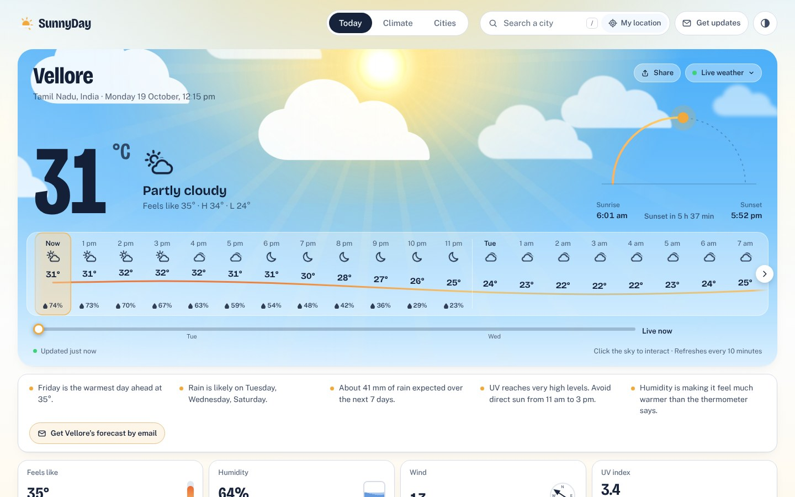

## Contents

- [Features](#features)
- [Screenshots](#screenshots)
- [Architecture](#architecture)
- [How it works](#how-it-works)
- [Tech stack](#tech-stack)
- [Run it locally](#run-it-locally)
- [Deploy to AWS](#deploy-to-aws)
- [Tests](#tests)
- [Project structure](#project-structure)
- [Data sources and credits](#data-sources-and-credits)

## Features

### Today: a live, animated forecast
- **A sky that matches the real weather.** Clouds drift and rain and snow fall at the angle of the real wind. There's lightning in storms, fog banks, a sun that moves across the sky and turns golden near sunset, and a moon with twinkling stars and shooting stars at night.
- **Bright days and deep nights.** The whole page, not just the panel, turns sunny by day and dark by night in the city you're viewing.
- **48-hour look-ahead.** Drag the slider, click an hour or use the arrow keys, and the sky, temperature and sun move to that hour.
- **Weather warnings** for extreme heat, thunderstorms, heavy rain and poor air quality.
- **Animated detail gauges** for feels-like, humidity, wind, UV, air quality, pressure and daylight. There's also an expandable 7-day forecast, 48-hour temperature and rain charts, and plain-language insights such as which day is warmest and when rain is likely.
- **Interactive sky:** click it for lightning, sparkles, snow puffs or shooting stars. A **Preview an effect** menu shows any weather on demand.

### Climate: decades of records, analysed in the browser
- **Warming stripes** for 10 to 40 years of ERA5 daily data, with a year-by-year trend line, the warmest and coolest years, and hover details.
- **Trend statistics:** warming per decade (least squares and Sen's slope) with a **Mann-Kendall significance test**, this year so far against the baseline, rainfall trends, and days at or above 35 °C.
- Charts of annual mean temperature, annual rainfall, hot days, a typical year, seasons (winter, summer, monsoon, post-monsoon), decades and records.

### Cities
- Live conditions for nine Indian cities on animated cards, sortable by temperature, chance of rain or humidity.

### Email updates (accounts)
- Sign up with an email and password, verified with a 6-digit code.
- Choose a **city**, **how often** (once a day, twice a day, once a week or severe weather only), and the **time** in your own time zone.
- **Severe-weather alerts**, **pause**, a **test email**, an in-browser **email preview**, one-click **unsubscribe** and **delete account**.
- Emails sent after 5 pm look ahead to tomorrow, and the weekly email covers the week ahead.

### Everywhere
- Search any city worldwide; **My location** finds your nearest place name.
- **Share** a link that opens the same city.
- Light, dark or automatic theme. Works on phones, tablets and wide screens. Full keyboard support, and respects reduced-motion settings.

## Screenshots

| Day | Night |
|---|---|
|  | 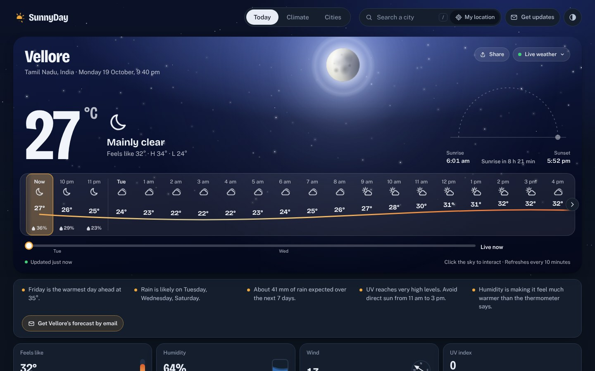 |

| Thunderstorm effect | Details, 7-day forecast and charts |
|---|---|
| 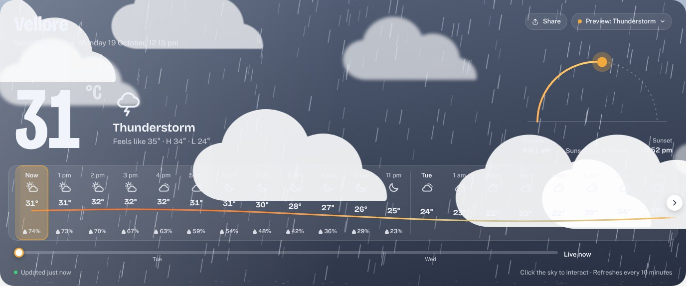 | 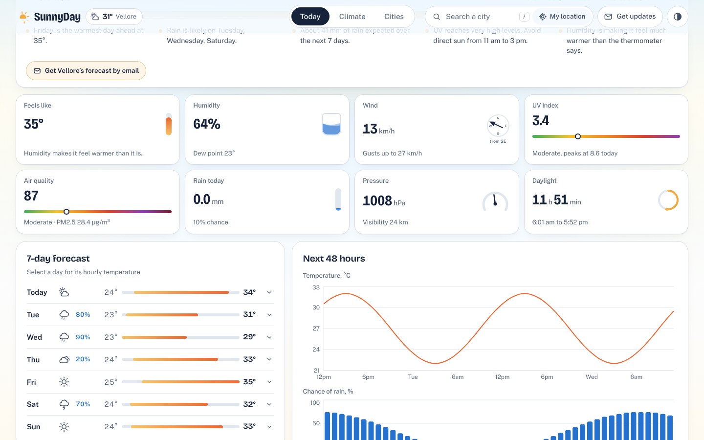 |

| Climate stripes and trends | Climate charts |
|---|---|
| 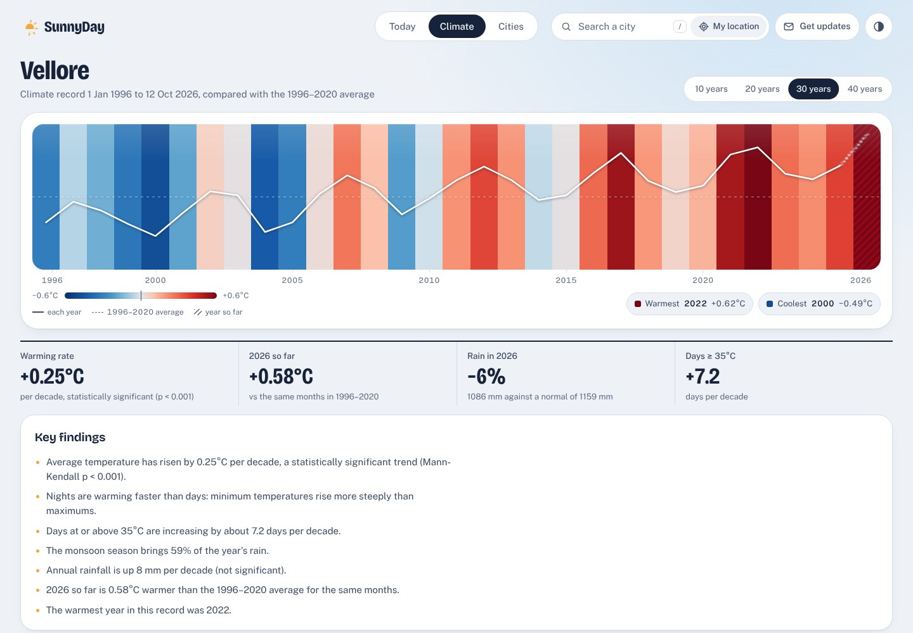 | 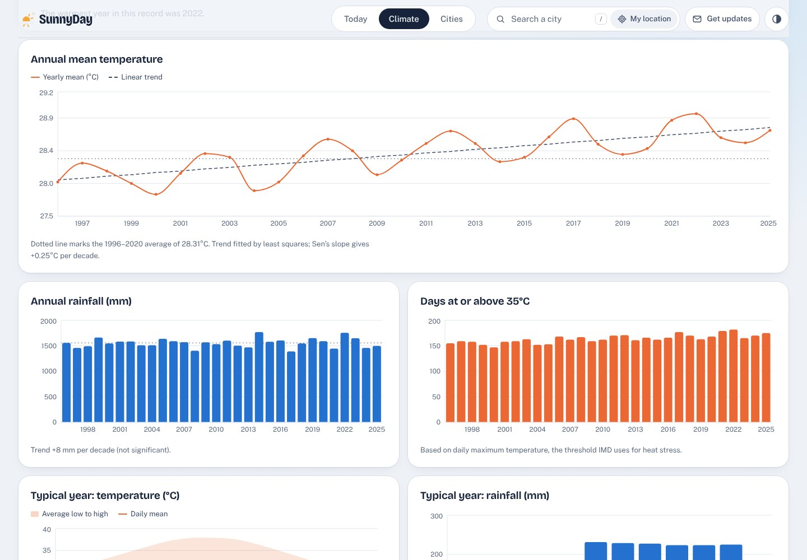 |

| Cities | Email update settings |
|---|---|
| 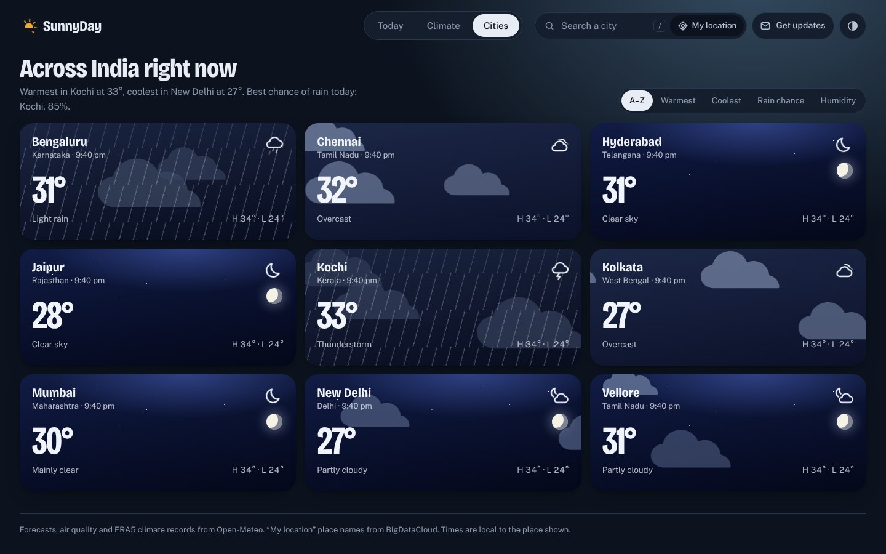 | 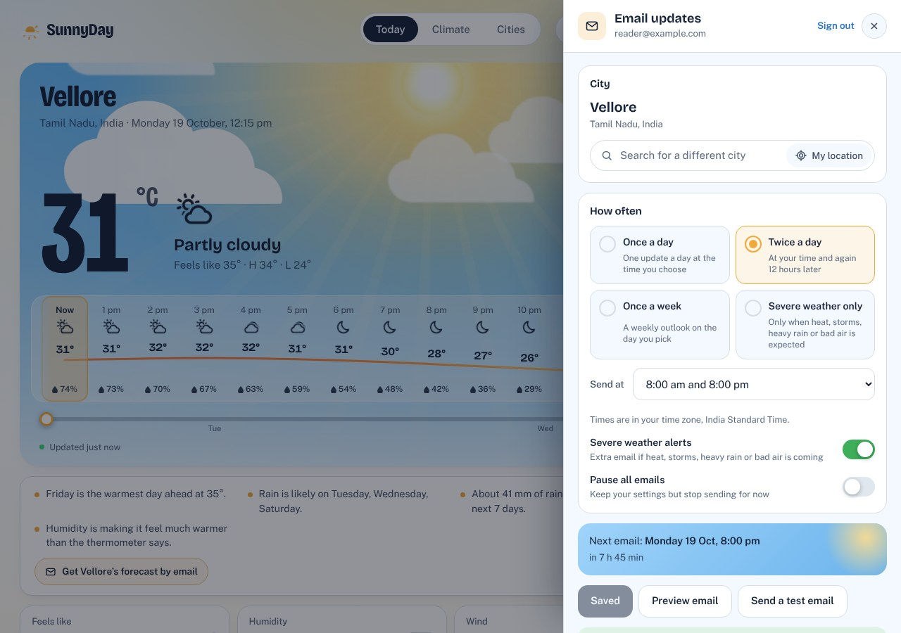 |

| The email | Phone, day | Phone, night |
|---|---|---|
| 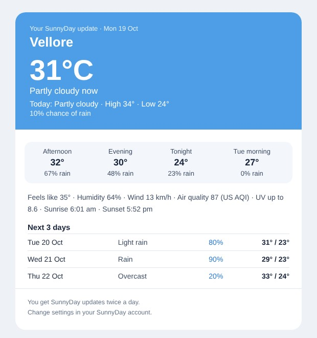 | 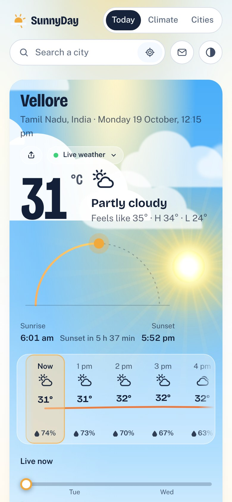 | 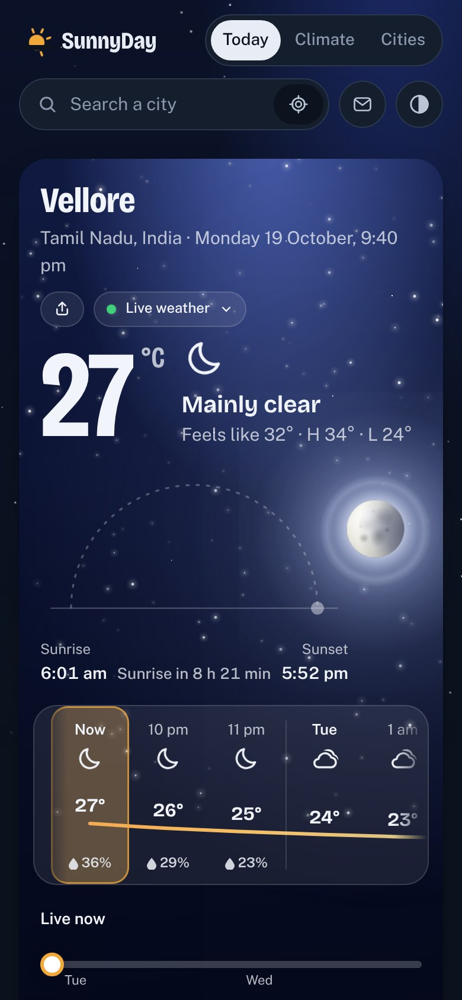 |

## Architecture

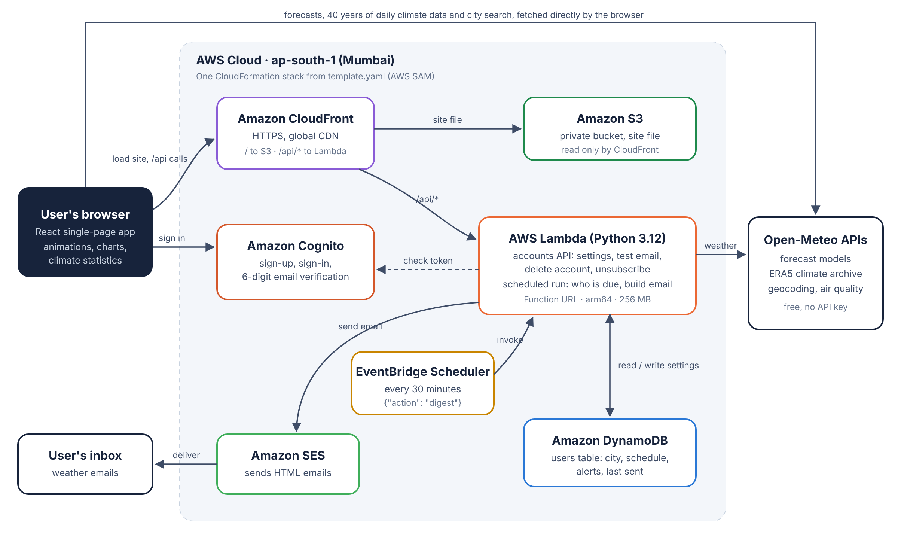

Everything is defined in one AWS SAM template (`template.yaml`) and deployed with one command.

| Part | AWS service | What it does | Cost on the free tier |
|---|---|---|---|
| Website | **S3** (private) + **CloudFront** | Serves the single-file site over HTTPS. CloudFront routes `/api/*` to Lambda | CloudFront always free; S3 a few cents at most |
| Accounts | **Cognito** | Sign-up, sign-in, email verification codes, password reset | Free up to 10,000 monthly users |
| Settings | **DynamoDB** | One item per user: city, schedule, alerts, last sent | Always free (2 RCU / 2 WCU) |
| API and emails | **Lambda** (Python 3.12, arm64) + Function URL | Account API, schedule logic, email builder | Always free (1M requests/month) |
| Schedule | **EventBridge Scheduler** | Runs the email job every 30 minutes | 14M invocations/month free |
| Email | **SES** | Sends HTML and plain-text emails | $0.10 per 1,000 emails |

The browser fetches forecasts and climate data straight from Open-Meteo, so weather views never touch the backend. Lambda is only used for accounts and emails.

## How it works

**Forecasts.** Current conditions, 7-day hourly and daily data, and air quality come from Open-Meteo, cached for 9 minutes and refreshed every 10. Weather codes map to scene types (clear, partly cloudy, overcast, fog, drizzle, rain, storm, snow), which drive the canvas and CSS animations.

**Climate analysis.** Up to 40 years of ERA5 daily mean, maximum and minimum temperature and rainfall are downloaded once and cached for a week. In the browser, SunnyDay then:
- groups days into years, months and seasons;
- compares each year with the 1991–2020 WMO normal period (or the full record when it's shorter);
- fits a least-squares trend and Sen's slope;
- tests significance with the Mann-Kendall test;
- counts hot days (≥ 35 °C, the IMD heat threshold) and rainy days (≥ 2.5 mm).

**Email schedule.** EventBridge runs the Lambda every 30 minutes. Each user's local time is worked out from their time-zone offset, so half-hour zones such as India Standard Time get emails exactly on the hour. A user is due when the window matches their chosen hour, or hours for twice-a-day and alert checks, and their weekday for weekly emails. Each slot is recorded, so nothing is sent twice. Alert-only users get at most one alert a day.

**Security.** The site bucket is private and readable only through CloudFront (Origin Access Control). The API checks the Cognito access token on every request. Unsubscribe links are signed with a per-deployment HMAC secret. The Lambda can only touch its own table, send email, and delete users from its own user pool.

## Tech stack

- **Frontend:** React 19, Vite 8 (builds to one self-contained `dist/index.html`), Recharts, Canvas 2D and CSS animations, self-hosted Bricolage Grotesque and Public Sans fonts
- **Backend:** Python 3.12 on AWS Lambda, boto3, no other dependencies
- **Infrastructure:** AWS SAM / CloudFormation, CloudFront, S3, Cognito, DynamoDB, EventBridge Scheduler, SES
- **Data:** Open-Meteo Forecast, Air Quality, Geocoding and ERA5 Archive APIs

## Run it locally

Needs Node.js 18 or newer.

```bash
npm install
npm run dev      # http://localhost:5173 with live reload
npm run build    # rebuilds dist/index.html
```

You can also just double-click `dist/index.html`. It works straight from disk. Accounts switch on once the site is deployed.

## Deploy to AWS

1. Create an AWS account and add a zero-spend budget under **Billing → Budgets**.
2. Install the [AWS CLI v2](https://awscli.amazonaws.com/AWSCLIV2.msi), [AWS SAM CLI](https://github.com/aws/aws-sam-cli/releases/latest/download/AWS_SAM_CLI_64_PY3.msi) and Node.js.
3. Create an IAM user with an access key and run `aws configure` with the region your account uses (`ap-southeast-2` for new AWS projects in India; pass `-Region` to the scripts for any other).
4. In this folder run:

   ```powershell
   Set-ExecutionPolicy -Scope Process Bypass
   .\deploy.ps1 -SenderEmail you@example.com
   ```

   This creates every resource, builds the site with the account settings filled in, uploads it, and prints the live `https://….cloudfront.net` address.
5. Click the verification link AWS emails to the sender address.
6. New SES accounts are in **sandbox mode** and can only send to verified addresses. For a demo, verify your own address in the SES console (**Identities → Create identity**). To email anyone, choose **Request production access** and describe SunnyDay as a weather-update service people sign up for, with an unsubscribe link in every email.

Run `.\deploy.ps1` again after any change. `.\destroy.ps1` deletes everything.

## Tests

```bash
python -m unittest discover -s tests
```

The tests cover the backend with in-memory stand-ins for DynamoDB, Cognito and SES:
- sign-in checks and settings validation
- send windows across time zones, including half-hour offsets
- email content in the morning, evening and weekly versions
- alerts, SES sandbox and error handling
- the test-email cooldown, signed unsubscribe links and account deletion

## Project structure

```
src/
  App.jsx                      layout, tabs, theme, place state, shared links
  components/Today.jsx         forecast view, warnings, share
  components/Climate.jsx       climate analytics view and warming stripes
  components/Cities.jsx        city overview
  components/Search.jsx        city search with recents and My location
  components/HourlyStrip.jsx   48-hour strip with temperature curve
  components/Tiles.jsx         animated detail gauges
  components/WeekList.jsx      expandable 7-day forecast
  components/DaylightArc.jsx   sunrise-to-sunset arc
  components/WeatherIcon.jsx   animated weather icons
  components/Account.jsx       sign-in drawer and email settings
  components/EmailPreview.jsx  in-browser preview of the email
  components/scene/            animated skies: canvas rain, snow, lightning; CSS clouds, sun, moon, stars, fog
  lib/weather.js               Open-Meteo client, caching, insights and warnings
  lib/climate.js               trend statistics and climate analysis
  lib/auth.js                  Cognito sign-up and sign-in over HTTPS (no SDK)
  lib/account.js               account API calls and next-email calculation
  lib/motion.js                count-up numbers, scroll reveals, live clock, tilt
  styles.css                   design tokens, light and dark themes
backend/app.py                 Lambda: accounts API, schedule, email builder, SES
tests/test_backend.py          backend tests
template.yaml                  AWS SAM infrastructure
deploy.ps1 / destroy.ps1       one-command deploy and tear-down
docs/                          architecture diagram and screenshots
```

## Data sources and credits

- Weather, air quality, geocoding and ERA5 climate data: [Open-Meteo](https://open-meteo.com) (CC BY 4.0). Free for non-commercial use, up to 10,000 requests a day, no API key.
- Place names for **My location**: [BigDataCloud](https://www.bigdatacloud.com) free client-side reverse geocoding.
- ERA5 reanalysis: Copernicus Climate Change Service (C3S), ECMWF.
